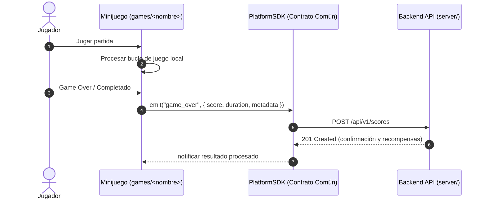

# Tobi's Minigames - Especificaciones de Minijuegos

Documento técnico que detalla el desarrollo, estándares e integración de los minijuegos web independientes de **TOBY'S MINI GAMES** dentro del directorio `games/`.

---

## 1. Contexto del Área `games/`

El directorio `games/` contiene las aplicaciones web interactivas jugables que se ejecutan directamente en el navegador del usuario.

> [!IMPORTANT]
> **Distinción fundamental de responsabilidades:**
> - `games/` alberga las **aplicaciones cliente jugables** (código frontend del juego, renderizado, canvas, bucles de juego).
> - `server/internal/modules/games/` administra los **metadatos en backend** (catálogo, registro de juegos en base de datos, umbrales y reglas de puntuación).
> - No se debe mezclar el código del backend con el de los minijuegos.

---

## 2. Tecnologías Previstas

Cada minijuego se ejecuta en el entorno del navegador y puede utilizar:

| Tecnología | Uso / Ámbito |
| :--- | :--- |
| **HTML5 Canvas / DOM** | Contenedor principal de renderizado y estructura del juego. |
| **CSS3** | Estilos visuales del juego, diseño responsive y adaptabilidad de pantalla. |
| **JavaScript / TypeScript** | Lógica de estados, reglas del juego, bucle principal y cálculo de puntuación. |
| **Phaser 3** | Motor 2D permitido **únicamente cuando las características del juego lo justifiquen** (físicas complejas, colisiones avanzadas o manejo intensivo de sprites). Para juegos sencillos (como trivia, tarjetas o memoria), priorizar soluciones ligeras en Canvas/DOM. |

---

## 3. Estructura del Directorio `games/`

Cada minijuego es un proyecto independiente con su propia organización interna:

```text
games/
├── GAMES.md         # Este documento de especificaciones
├── trivia/          # Minijuego de preguntas y respuestas
│   └── ...
├── memory/          # Minijuego de emparejamiento de cartas / memoria
│   └── ...
└── ...              # Futuros minijuegos independientes
```

---

## 4. Principios de Diseño para los Minijuegos

1. **Aislamiento Total:** Cada minijuego debe poder ejecutarse y probarse de forma local y autónoma en el navegador.
2. **Cero Lógica de Backend:** Los minijuegos no contienen lógica de base de datos ni credenciales secretas del servidor.
3. **Ligereza y Rendimiento:** Optimizar assets gráficos y de audio para garantizar carga inmediata sin descargas pesadas.
4. **Diseño Responsive:** Los juegos deben adaptarse correctamente a diferentes resoluciones de pantalla y dispositivos.

---

## 5. Integración con la Plataforma: `PlatformSDK`

Se contempla un contrato unificado de integración denominado **`PlatformSDK`**, encargado de estandarizar la comunicación entre el contenedor de la plataforma (host) y el minijuego:

- **Autenticación / Sesión de juego:** Notificar al juego que el usuario está listo y pasarle el identificador de sesión.
- **Control de Ciclo de Vida:** Eventos de inicio de partida (`game_start`), pausa (`game_pause`) y reinicio.
- **Reporte de Fin de Partida:** Envío de resultados al servidor (`score`, tiempo de juego en segundos, métricas de partida).

> [!NOTE]
> El diseño definitivo de la API del `PlatformSDK` queda **pendiente** hasta que se acuerde e implemente el primer minijuego formal del proyecto.

### Flujo Conceptual de Comunicación



---

## 6. Reglas de Desarrollo para Minijuegos

1. **No implementar minijuegos en esta fase:** El desarrollo de los minijuegos comenzará una vez acordado el contrato del `PlatformSDK` y la primera mecánica seleccionada.
2. **Consultar siempre `games/GAMES.md`:** Toda adición o modificación en este directorio debe alinearse con las especificaciones aquí establecidas.
