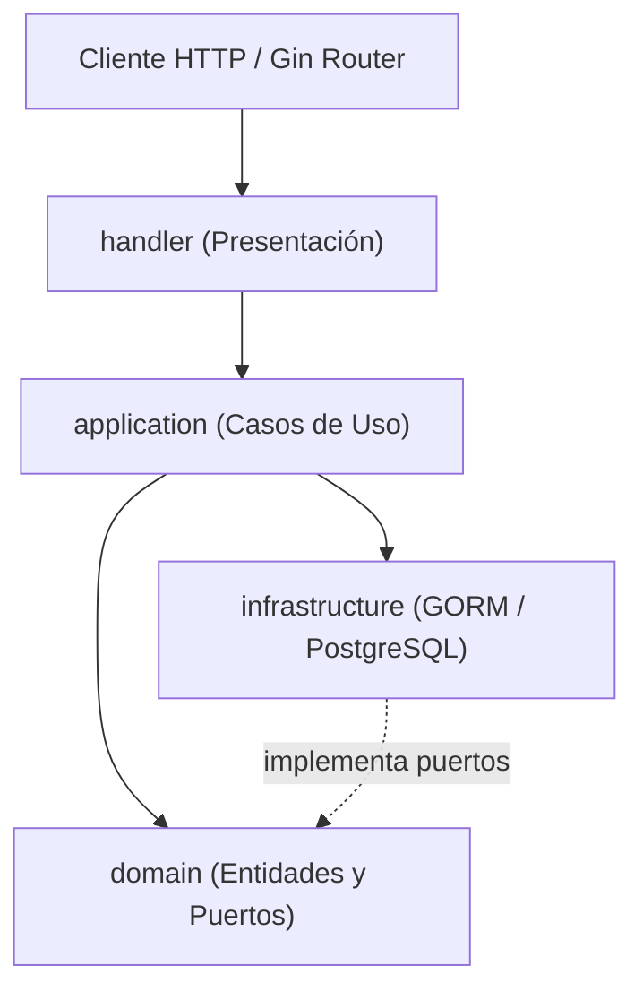

# Tobi's Minigames - Especificaciones del Backend

Documento técnico que detalla la arquitectura, estándares, módulos y reglas de negocio para el desarrollo del backend de **TOBY'S MINI GAMES** dentro del directorio `server/`.

---

## 1. Contexto del Área `server/`

El directorio `server/` alberga el núcleo del backend de la plataforma, implementado como un monolito modular en Go. Provee una API REST para la gestión de usuarios, autenticación, persistencia de puntuaciones, rankings, economía virtual y administración de los minijuegos.

> [!IMPORTANT]
> **Distinción clave:** 
> - `server/internal/modules/games/` administra los metadatos, catálogo y lógica de negocio de los juegos en el backend.
> - El directorio raíz `games/` contiene las aplicaciones web jugables independientes que corren en el navegador del cliente.

---

## 2. Stack Tecnológico Acordado

| Componente | Tecnología | Propósito y Justificación |
| :--- | :--- | :--- |
| **Lenguaje** | **Go 1.24+** | Alto rendimiento, tipado estático robusto, concurrencia nativa y bajo consumo de memoria. |
| **Framework HTTP** | **Gin Framework** | Enrutador HTTP eficiente, minimalista y con soporte flexible de middlewares. |
| **ORM** | **GORM** | Mapeo objeto-relacional para agilizar operaciones de persistencia en PostgreSQL. |
| **Base de Datos** | **PostgreSQL** | Motor relacional para asegurar integridad transaccional y consistencia de datos. |
| **Contenedores** | **Docker** (`server/Dockerfile`) | Imagen estandarizada para empaquetado del servicio backend. |
| **Migraciones** | **SQL versionado** (`server/migrations/`) | Scripts incrementales para trazabilidad y versionado de esquemas. |
| **Seguridad** | **JWT & bcrypt** | Autenticación stateless mediante tokens y hashing robusto de contraseñas. |
| **Caché / Sesiones** | **Redis** *(Futuro)* | Integración posterior planificada **únicamente** cuando exista una necesidad justificada (rankings de alta frecuencia, rate limiting). |

> [!NOTE]
> La orquestación de servicios en desarrollo se realiza mediante el `docker-compose.yml` ubicado en la raíz del repositorio. El archivo `server/Dockerfile` pertenece exclusivamente al backend.

---

## 3. Arquitectura: Monolito Modular (Hexagonal Lite)

El backend sigue una arquitectura **Hexagonal Lite (Puertos y Adaptadores)** organizada por módulos funcionales desacoplados.

### 3.1. Capas por Módulo (`server/internal/modules/<modulo>/`)

Cada módulo funcional se divide en cuatro capas estrictas:

```text
server/internal/modules/<modulo>/
├── domain/          # Entidades puras, Value Objects e interfaces (puertos)
├── application/     # Casos de uso y orquestación de la lógica de negocio
├── infrastructure/  # Repositorios GORM, adaptadores de DB y clientes externos
└── handler/         # Controladores Gin, rutas HTTP, DTOs de entrada y salida
```

#### Responsabilidades y Reglas de Dependencia:

1. **`domain/` (Dominio):**
   - Entidades y reglas de negocio puras.
   - Definición de interfaces de repositorios y servicios externos (puertos de salida).
   - **Regla estricta:** No debe importar Gin, GORM, PostgreSQL ni detalles de infraestructura.

2. **`application/` (Aplicación):**
   - Implementa los casos de uso (e.g. `RegisterUserUseCase`, `SubmitScoreUseCase`).
   - Orquesta la lógica del negocio y transacciones.
   - Depende exclusivamente de `domain/`.

3. **`infrastructure/` (Infraestructura):**
   - Implementa los puertos definidos en el dominio utilizando GORM / PostgreSQL (e.g. `PostgresUserRepository`).
   - Conoce detalles de base de datos pero no conceptos de presentación HTTP.

4. **`handler/` (Presentación / Adaptador HTTP):**
   - Define las rutas HTTP y controladores Gin.
   - Deserializa y valida los DTOs de entrada (request).
   - Invoca a los casos de uso de `application/`.
   - Transforma resultados o errores en respuestas JSON unificadas (response).



---

## 4. Organización del Directorio `server/`

```text
server/
├── cmd/
│   └── api/
│       └── main.go                  # Punto de entrada: inicialización de config, DB, rutas y servidor
│
├── internal/
│   ├── modules/                     # Módulos funcionales desacoplados
│   │   ├── auth/                    # Registro, login, refresh tokens, middleware JWT
│   │   ├── users/                   # Gestión de perfiles y cuentas de usuario
│   │   ├── games/                   # Catálogo de juegos, metadatos y configuración en backend
│   │   ├── scores/                  # Registro, validación y trazabilidad de puntuaciones
│   │   ├── rankings/                # Tablas de clasificación globales y periódicas
│   │   ├── economy/                 # Moneda virtual, recompensas y tienda
│   │   ├── reviews/                 # Calificaciones y reseñas de juegos
│   │   └── reports/                 # Reporte de incidencias y soporte
│   │
│   ├── shared/                      # Componentes transversales reutilizables
│   │   ├── database/                # Conexión DB, helpers y transacciones
│   │   ├── middleware/              # Auth JWT, CORS, Logger, Recovery
│   │   ├── errors/                  # Tipos de errores de dominio y mapeo HTTP
│   │   ├── response/                # Formato estándar JSON de respuestas
│   │   └── security/                # Hashing bcrypt y gestión de JWT
│   │
│   └── infrastructure/
│       └── config/                  # Lectura de variables de entorno y configuración
│
├── migrations/                      # Scripts SQL versionados (up / down)
├── tests/                           # Pruebas de integración transversales
├── Dockerfile                       # Construcción de la imagen Docker del backend
├── .env.example                     # Plantilla de variables de entorno del servidor
└── go.mod                           # Módulo Go y dependencias versionadas
```

---

## 5. Módulos Funcionales del Backend

1. **`auth`:** Registro de cuentas, autenticación con bcrypt, emisión/validación de tokens JWT y middleware de protección de rutas.
2. **`users`:** Administración de perfiles, datos del jugador y subperfiles específicos por juego.
3. **`games`:** Catálogo de minijuegos registrados en la plataforma, configuración de umbrales y metadatos.
4. **`scores`:** Recepción de resultados de partidas, validación de integridad (duración vs puntuación) y almacenamiento de récords individuales.
5. **`rankings`:** Tablas de clasificación por minijuego, globales y temporales (diario, semanal, histórico).
6. **`economy`:** Puntos/monedas acumuladas, catálogo de recompensas (avatares, cosméticos) y procesamiento transaccional de canjes.
7. **`reviews`:** Calificaciones (1 a 5 estrellas) y opiniones de usuarios sobre los minijuegos.
8. **`reports`:** Registro de anomalías técnicas, denuncias de comportamiento o incidencias en partidas.

---

## 6. Reglas de Persistencia y Transacciones

1. **Transacciones Obligatorias:** Toda operación que involucre múltiples escrituras o afecte saldos e inventarios debe ejecutarse dentro de una transacción de base de datos.
   - *Ejemplo en `economy`:* Validar saldo → Descontar monedas → Crear registro de ítem → Registrar auditoría.
2. **Migraciones Versionadas:** No utilizar migraciones automáticas destructivas en entornos productivos o compartidos. Todo cambio de esquema requiere un archivo `.sql` en `server/migrations/`.
3. **Independencia del Dominio:** Las entidades de `domain/` no deben estar atadas a tags o tipos exclusivos de GORM.

---

## 7. Formato Estándar de Respuestas HTTP

Todas las respuestas expuestas por los handlers deben utilizar el formato unificado provisto por `internal/shared/response`:

### Respuesta Exitosa:
```json
{
  "success": true,
  "data": { ... },
  "message": "Operación realizada con éxito"
}
```

### Respuesta de Error:
```json
{
  "success": false,
  "error": {
    "code": "INVALID_CREDENTIALS",
    "message": "El correo o la contraseña son incorrectos",
    "details": null
  }
}
```
